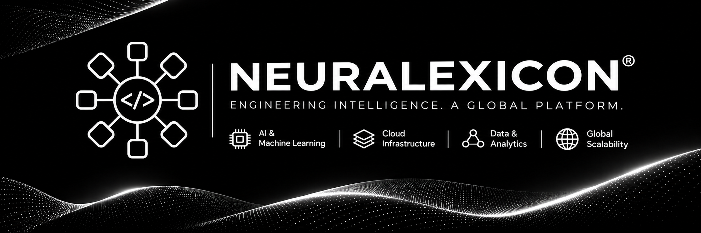

  

  <a href="https://neuralexicon.com"><strong>Website</strong></a>
  &nbsp;•&nbsp;
  <a href="https://github.com/neuralexicon"><strong>GitHub</strong></a>
  &nbsp;•&nbsp;
  <a href="mailto:neuralexicon1@gmail.com"><strong>Contact</strong></a>

  
  
  

---

## About Neuralexicon

**Neuralexicon** is an AI and software engineering company focused on designing and building intelligent digital products, AI-enabled applications, and scalable software systems.

We bring together applied artificial intelligence, thoughtful product engineering, and modern infrastructure to turn complex ideas into practical technology. Our work spans intelligent automation, agent-based systems, full-stack software, backend platforms, and cloud-connected applications.

Our principle is simple: **engineering should make intelligence useful.**

## What We Do

<table>
  <tr>
    <td width="50%" valign="top">
      <h3>Artificial Intelligence</h3>
      Applied AI, generative AI integrations, large language model applications, retrieval-augmented generation, and machine-learning-enabled experiences.
    </td>
    <td width="50%" valign="top">
      <h3>AI Agents & Automation</h3>
      Agent workflows, tool integration, task orchestration, and automation designed to connect services and simplify multi-step processes.
    </td>
  </tr>
  <tr>
    <td width="50%" valign="top">
      <h3>Software Engineering</h3>
      Full-stack applications, backend services, API design, real-time systems, and maintainable product architectures.
    </td>
    <td width="50%" valign="top">
      <h3>Cloud & Data Infrastructure</h3>
      Database-backed platforms, background processing, object storage, containerized services, and scalable deployment foundations.
    </td>
  </tr>
</table>

## Products & Projects

### Neuralexicon — Digital Platform

Our company website and digital presence, representing the Neuralexicon brand and its software and AI initiatives.

- Website: [neuralexicon.com](https://neuralexicon.com)

### AgentFlow AI — AI Agent Initiative

An initiative exploring AI agents, connected tools, and orchestrated workflows for automating useful, multi-step tasks.

- Focus: agent workflows, tool use, and intelligent automation.

> Project descriptions are intentionally concise; individual repositories contain the implementation details, documentation, and current project status.

## Technology

Our projects use technologies selected to fit their requirements. The following represents our engineering toolkit, not a claim that every technology is used in every product.

**Frontend**

  
  
  
  

**Backend & APIs**

  
  
  
  
  

**AI & Data**

  
  
  
  
  

**Databases, Cloud & DevOps**

  
  
  
  
  
  
  

## Engineering Principles

- **Purposeful intelligence** — use AI where it creates practical value.
- **Engineering quality** — prioritize clarity, reliability, security, and maintainability.
- **Scalable foundations** — design systems that can evolve with their needs.
- **Thoughtful products** — balance technical capability with usability.
- **Continuous learning** — explore emerging tools and share useful knowledge.

## Open Source & Collaboration

We value thoughtful collaboration with developers, researchers, founders, and teams working on useful technology. We are interested in open-source contributions and partnerships across AI applications, agent systems, developer tools, software platforms, and infrastructure.

For project-specific contributions, please read the relevant repository's `README.md`, contribution guidelines, and issue templates before opening a pull request or issue.

## Connect

- **Website:** [neuralexicon.com](https://neuralexicon.com)
- **GitHub:** [github.com/neuralexicon](https://github.com/neuralexicon)
- **Email:** [neuralexicon1@gmail.com](mailto:neuralexicon1@gmail.com)

---

  <strong>NEURALEXICON</strong> 
  <em>Engineering Intelligence. A Global Platform.</em>  
  Building intelligent technology through thoughtful engineering.

